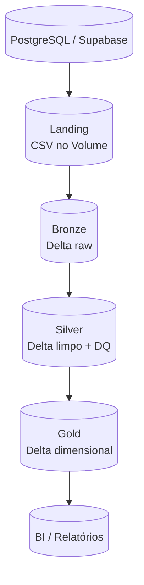

# Arquitetura Medalhao

A arquitetura Medalhão organiza o lakehouse em camadas, cada uma com um nível maior de qualidade e de estruturação dos dados.

| Camada | Schema | Formato | Conteúdo | Quem consome |
|---|---|---|---|---|
| Landing | `workspace.landing` (volume `dados`) | CSV | Cópia fiel da fonte | Engenharia de dados |
| Bronze | `workspace.bronze` | Delta | Dados brutos + metadados de ingestão | Engenharia de dados |
| Silver | `workspace.silver` | Delta | Dados limpos, tipados e deduplicados | Analistas, cientistas de dados |
| Gold | `workspace.gold` | Delta | Modelo dimensional (fatos e dimensões) | BI, relatórios |

## Por que usar camadas?

- **Rastreabilidade:** cada etapa guarda de onde o dado veio (`filename`, `FILENAME_BRONZE`) e quando foi processado (`datetime_bronze`, `FILEDATE_SILVER`, `FILEDATE_GOLD`).
- **Reprocessamento:** se uma regra de qualidade muda, basta refazer Bronze -> Silver sem ir de novo à fonte.
- **Separação de responsabilidades:** ingestão, limpeza e modelagem de negócio evoluem de forma independente.

## Delta Lake

Todas as tabelas Bronze, Silver e Gold são **Delta MANAGED**: o Unity Catalog gerencia o armazenamento, e o Delta fornece transações ACID, histórico de versões e evolução de schema.

!!! note "Rastreabilidade"
    Cada camada adiciona metadados: `filename` / `FILENAME_BRONZE` e `datetime_bronze` / `FILEDATE_SILVER` / `FILEDATE_GOLD`. Isso permite auditoria completa da linha.
