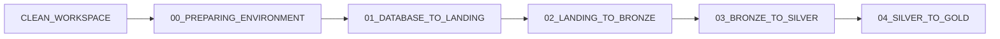

# Execução

Instruções de execução dos notebooks na ordem correta.

## Ordem

| # | Notebook | O que faz |
|---|---|---|
| 0 | `00_PREPARING_ENVIRONMENT` | cria schemas e volume |
| 1 | `01_DATABASE_TO_LANDING` | extrai do PostgreSQL para CSV |
| 2 | `02_LANDING_TO_BRONZE` | CSV para Delta (bronze) |
| 3 | `03_BRONZE_TO_SILVER` | renome + Data Quality (silver) |
| 4 | `04_SILVER_TO_GOLD` | modelo dimensional (gold) |
| - | `CLEAN_WORKSPACE` | limpeza total, **manual** |

## Antes da primeira execução

Crie o Secret Scope `lakehouse` com as credenciais da fonte (veja o README) ou informe os valores como parâmetros do Job.

## Execução manual

Abra cada notebook em ordem no Databricks e use **Run all**.

## Execução via Job

Use o `databricks_jobs.json` conforme `jobs_pipeline.md`.

## Reexecução

Os notebooks gravam com `overwrite` + `overwriteSchema`, então podem ser executados de novo sem limpar o ambiente.

!!! caution "CLEAN_WORKSPACE"
    `CLEAN_WORKSPACE` apaga schemas e volume. Execute manualmente somente quando quiser recomeçar do zero.
