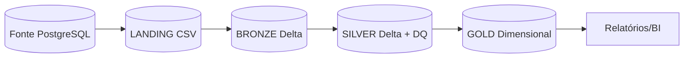

# Lakehouse com Databricks e Arquitetura Medalhao

## Visão geral

Este projeto implementa um pipeline de dados utilizando a arquitetura Medalhao no Databricks Free Edition com orquestração por Jobs & Pipelines.

!!! info "Objetivo do trabalho"
    Implementar Landing → Bronze → Silver → Gold com Databricks, Delta Lake e modelo dimensional Kimball, com Data Quality e orquestração automatizada.

### Fluxo visual

### Fluxo visual

### Camadas

- **Landing**: dados brutos extraídos da fonte em CSV
- **Bronze**: dados em Delta Lake sem transformação de conteúdo
- **Silver**: dados limpos, tipados e com Data Quality
- **Gold**: tabelas dimensionais Kimball

### Tabelas da fonte

| Tabela na fonte | Arquivo na landing | Tabela bronze / silver |
|---|---|---|
| `games` | `games.csv` | `metacritic_games` |
| `steam_metrics` | `steam_metrics.csv` | `steam_metrics` |
| `regional_sales` | `regional_sales.csv` | `regional_sales` |
| `how_long_to_beat` | `how_long_to_beat.csv` | `how_long_to_beat` |
| `walkthrough_links` | `walkthrough_links.csv` | `walkthrough_links` |

## Estrutura

Consulte a documentação nas seções ao lado.

### Começar agora

1. [Arquitetura Medalhao](arquitetura_medalhao.md) – entenda as camadas
2. [Execução](execucao.md) – ordem de execução e pré-requisitos
3. [Jobs e Pipeline](jobs_pipeline.md) – como criar o Job no Databricks

!!! tip "Dica"
    O repositório já traz `databricks_jobs.json`. Após importar como Git folder, basta importar o JSON e ajustar o caminho do Repos.
