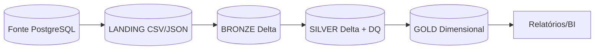

# Lakehouse com Databricks e Arquitetura Medalhao

## Visão geral

Este projeto implementa um pipeline de dados utilizando a arquitetura Medalhao no Databricks Free Edition.

### Fluxo visual

### Camadas

- **Landing**: dados brutos extraídos da fonte em CSV/JSON
- **Bronze**: dados em Delta Lake sem transformação
- **Silver**: dados limpos com Data Quality
- **Gold**: tabelas dimensionais Kimball

## Estrutura

Consulte a documentação nas seções ao lado.
