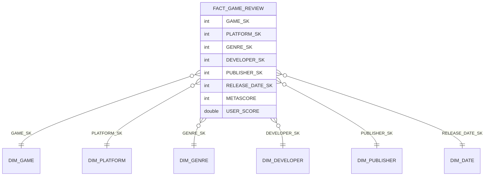

# Silver para Gold

Modelagem dimensional Ralph Kimball (`04_SILVER_TO_GOLD`).

## Esquema estrela

## Fato

**`fact_game_review`**: grão de uma linha por jogo/plataforma do Metacritic. Medidas: `METASCORE` (crítica, 0 a 100) e `USER_SCORE` (usuários, 0 a 10).

## Dimensões

| Dimensão | Chave substituta | Atributos |
|---|---|---|
| `dim_game` | `GAME_SK` | `GAME_ID`, `GAME_NAME` |
| `dim_platform` | `PLATFORM_SK` | `PLATFORM_NAME` |
| `dim_genre` | `GENRE_SK` | `GENRE_NAME` |
| `dim_developer` | `DEVELOPER_SK` | `DEVELOPER_NAME` |
| `dim_publisher` | `PUBLISHER_SK` | `PUBLISHER_NAME` |
| `dim_date` | `DATE_SK` (yyyyMMdd) | `DATE`, `YEAR`, `QUARTER`, `MONTH`, `MONTH_NAME`, `DAY`, `DAY_OF_WEEK`, `DAY_NAME`, `IS_WEEKEND` |

Toda dimensão tem o membro `-1 = NÃO INFORMADO`, usado quando a chave estrangeira da fato é nula. Todas as tabelas têm a coluna de auditoria `FILEDATE_GOLD`.

## Verificações

- A fato tem o mesmo número de linhas da silver (`assert` no notebook).
- Nenhuma FK fica sem correspondência, pois valores nulos apontam para o membro `-1`.

## Pendências do modelo

As tabelas `steam_metrics`, `regional_sales`, `how_long_to_beat` e `walkthrough_links` ainda precisam ser incorporadas ao modelo (novas fatos ou dimensões ligadas ao jogo).
